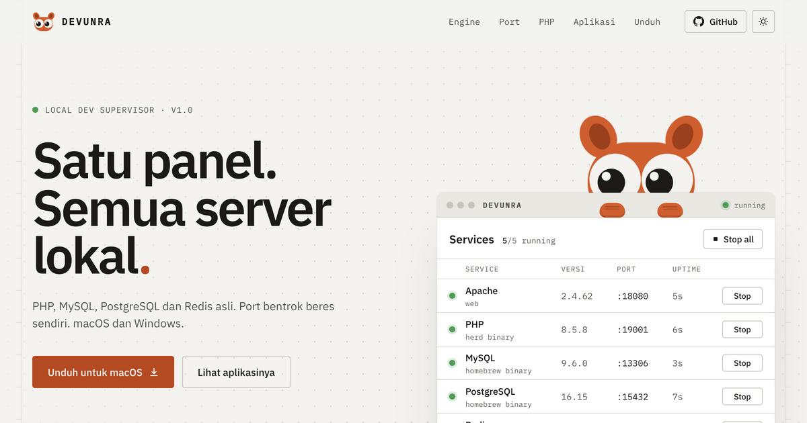

# DEVUNRA · web

Landing page untuk [DEVUNRA](https://github.com/Intra-Sepriansa/devunra/releases), panel untuk semua server lokal di macOS dan Windows.



Dibuat dengan React 18, Vite dan [motion](https://motion.dev). Screenshot di `public/img` diambil dari aplikasi aslinya; tarsius dan animasinya memakai geometri yang sama dengan aplikasi.

## Jalankan

```bash
npm install
npm run dev
```

`npm run build` menaruh hasilnya di `dist/`.

## Deploy

Alamat produksi: **https://devunra.arsinode.site/**, dihosting di **AWS Amplify Hosting**. App ID `d3m7ie18mkkxa7`, region `us-east-1`, branch `main`. Alamat AWS langsung: https://main.d3m7ie18mkkxa7.amplifyapp.com/.

Untuk memperbarui situs, gunakan Node.js 22+, AWS CLI v2, dan `zip`. Login dengan akun AWS yang memiliki akses ke aplikasi ini, lalu jalankan:

```bash
aws login --region us-east-1
npm ci
npm run deploy:aws
```

Perintah deploy membangun situs, mengunggah isi `dist/`, dan menunggu hasil deployment AWS. Konfigurasi publik disimpan di `aws-hosting.json`; kredensial AWS tidak disimpan dalam repo. GitHub Actions di `.github/workflows/build.yml` memeriksa build dan menyimpan hasilnya; publikasi ke AWS dilakukan lewat perintah deploy di atas.

Domain `arsinode.site` terdaftar di Spaceship, tetapi DNS aktif dikelola Cloudflare (`ganz.ns.cloudflare.com` dan `jen.ns.cloudflare.com`). Record produksi: `CNAME devunra → d1kh21krvwge9j.cloudfront.net`, DNS only, TTL 300 detik. Sertifikat HTTPS dikelola dan diperpanjang AWS Amplify. Pertahankan CNAME validasi ACM `_fa1cec517a9a44ead8958bd16314448d.arsinode.site` dalam mode DNS only agar perpanjangan sertifikat tetap berjalan.

Hosting ditagih sesuai pemakaian; lihat [harga AWS Amplify](https://aws.amazon.com/amplify/pricing/).
